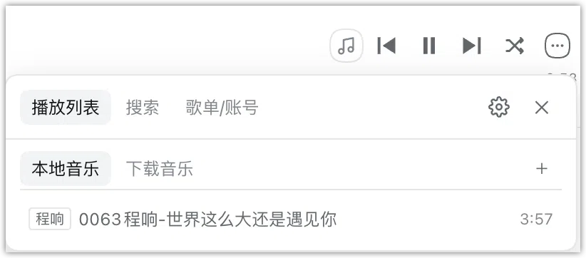

# dsh-music-player

DSH 桌面端迷你音乐播放器插件：在会话标题栏右上角（侧边栏开关左侧）注入一个迷你播放器，并在标题第二行（对话/轨迹行）右侧显示当前歌词。

## 截图

标题栏迷你播放器（含进度条与歌词行）：


更多（•••）弹窗——播放列表 / 搜索 / 歌单·账号，二级标签本地音乐 / 下载音乐：



## 功能

- **播放模式**：顺序 / 随机 / 单曲循环（弹窗底部按钮切换）。
- **本地文件夹**：点击「＋本地文件夹」调起系统文件夹选择面板选目录（面板不可用时退回手输路径），自动递归扫描音频（mp3/flac/m4a/aac/ogg/oga/wav/opus/aiff/wma），同名 `.lrc` 自动配对为歌词。
- **网络歌单**：粘贴文本歌单（每行 `歌名 - 歌手 http://…mp3`，或标准 M3U `#EXTINF` 格式）。
- **平台账号**：
  - 网易云：扫码登录（QR），登录后可加载“我的歌单”并播放；未登录也可免费搜索/播放。
  - B 站：粘贴 Cookie（SESSDATA 等）登录，加载收藏夹播放；未登录可搜索视频音频。
  - 酷我 / QQ 音乐：免登录搜索试听；**QQ 支持扫码登录**（手机 QQ 扫码，经 ptlogin2→graph oauth 换取 musicu 凭据），登录后可加载「我的歌单」并按账号权限取播放地址（VIP 歌取决于账号）。**酷我支持短信登录**（手机号 + 图形验证码 + 短信验证码）。
  - 酷狗：扫码登录（酷狗音乐 App），登录后可播放账号歌单；未登录时歌曲播放试听片段。
  - 汽水：扫码登录（**抖音 App 扫码**，车机开放协议，无需字节网页签名），登录后可加载「我的歌单」；未登录也可搜索/播放/看歌词。登录凭据（含 ticket）只存服务端状态文件，不回传页面。
- **免费聚合源**（pan）：接入知乎文章推荐的下歌吧（so.liumingye.cn，作者同 MyFreeMP3）。原 MyFreeMP3 直链 API（api.liumingye.cn）已停止服务（实测 CF 522），该免费源可搜索并获取歌词，播放地址多为网盘链接（点击搜索结果自动复制网盘链接）。
- **5sing**（5sing.kugou.com 中国原创音乐基地）：匿名搜索原创/翻唱/伴奏，SQ→HQ→LQ 三档直链播放，可下载（自动带歌词 dynamicWords 与封面）。
- **无损控**（wusunk.com）：WordPress 无损合集站，搜索结果为文章帖，点击自动复制网盘链接。文章另一站 24bit.net 全站 Cloudflare 人机验证（服务端拿不到页面），无法接入。
- **下载**：搜索结果行点 **⬇** 下载到下载目录（默认 `~/Music/dsh-music-player`），自动带歌词（`.lrc` sidecar + mp3 USLT 内嵌）与封面（sidecar + mp3 APIC 内嵌），网易云自动补全专辑/封面。
- **下载管理**：下载列表/设置页支持编辑元数据（歌名/歌手/专辑等，自动重写 ID3v2.3 并重命名文件）、单曲删除（红色图标 + 气泡确认）与多选批量删除。
- **设置页**：更多（•••）弹窗内 **⚙** 打开（居中模态）：第三方账号登录/退出、下载目录、主题色与每页条数（进度条与已播歌词同色）、快捷键管理。仅底部一个保存按钮（固定不随内容滚动），保存结果 toast 提示。
- **全局快捷键**（按系统预设，不冲突，可清除/重录）：macOS 默认 `⌥+←/→` 上一曲/下一曲、`⌥+P` 播放暂停、`⌥+M` 切播放模式；Windows/Linux 默认 `Ctrl+Alt+` 同组合。
- **搜索**：按歌曲（9 音源）或歌单（网易云、QQ音乐、汽水）搜索；歌曲结果支持翻页（‹ 上一页 / 第 N 页 / 下一页 ›，末页自动禁用），搜索框固定、仅结果区滚动。

## 安装

前置：已安装 DSH 桌面版（DeepSeek Harness）与 Node.js ≥ 20。

```bash
git clone git@github.com:qipengxiang/dsh-music-player.git
```

安装指定版本时，克隆对应 tag（各版本见仓库 tags）：

```bash
git clone --branch v0.4.21 --depth 1 git@github.com:qipengxiang/dsh-music-player.git
```

在你的 DSH profile（默认 `~/.dsh`）中登记本地插件：

1. 编辑 profile 的 `package.json`，在 `dependencies` 加入：

   ```json
   "dsh-music-player": "link:<本仓库克隆的绝对路径>/dsh-music-player"
   ```

2. 把 `"dsh-music-player"` 加入 `package.json` 的 `dsh.profile.bundles` 数组（缺了则插件不会加载）。
3. 在 profile 目录执行 `pnpm install`，然后完全退出并重启 DSH（macOS `Cmd+Q`）。

安装成功后标题栏右上角出现迷你播放器；插件管理清单中显示「音乐播放器」。

## 使用

1. 标题栏右上角出现迷你播放器；点 **•••** 打开弹窗：
   - 播放列表 tab：本地音乐 / 下载音乐（＋ 添加本地文件夹或网络歌单，▶ 播放全部）。
   - 搜索 tab：选音源、输入关键词搜索歌曲或歌单；歌曲行 **⬇** 下载。
   - 歌单·账号 tab：平台登录态管理，登录后加载账号歌单。
2. 播放时对话/轨迹行右侧显示当前歌词（已播部分按主题色渐变）。
3. 更多弹窗 **⚙** 打开设置：账号、下载目录、主题色、快捷键。

## 实现说明

- 服务端（`index.js`）注册 `/dsh-music-player/*` HTTP 路由：状态持久化（`~/.dsh/dsh-music-player.json`，原子写）、目录扫描、音源 API（weapi/wbi 自实现签名）、本地文件 Range 流、远程流代理（Referer/UA 伪装 + 私网地址拦截）。
- 客户端（`client.js`）注入 `conversation.session.header.utilities` 槽渲染迷你播放器；歌词通过 MutationObserver 挂到 `.tabs` 行并按播放器左缘对齐。
- 账号 Cookie 只存服务端状态文件，不回传给页面脚本。

## 自检

```bash
node --test tests/self-check.mjs
```
